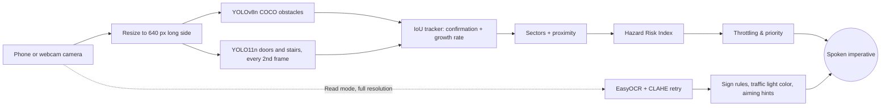

# Real-Time Actionable Guidance for the Visually Impaired Using Edge Vision and Spatially Prioritized Speech Synthesis

**Authors:** Mayank Raj, et al.  
**Department of Computer Science & Engineering**  
**Date:** October 2026  

---

## Abstract
Traditional assistive vision solutions for visually impaired individuals primarily focus on passive scene description ("there is a chair ahead") or require deliberate snapshot queries. Such approaches suffer from high cognitive load, lack of timely navigation cues, and vulnerability to network latencies when cloud vision APIs are utilized. This paper proposes a lightweight, offline assistive framework that transforms live monocular video from a phone or laptop camera into concise, prioritized, imperative spoken actions (e.g., *"Stop! stairs ahead"*, *"Door on your left"*, *"Person approaching from your right"*). Two detectors run side by side: a COCO-pretrained YOLOv8 nano model for general obstacles, and a YOLO11 nano model that we fine-tuned on Open Images V7 for doors and stairs, two navigation-critical classes missing from COCO. A lightweight tracker filters single-frame false alarms and estimates approach from the growth rate of each bounding box, and a **Hazard Risk Index (HRI)** ranks hazards by proximity, alignment with the walking path, class severity and approach. A second *Read mode* reads signs with OCR, explains common sign types (exit, no entry, warning, push/pull, traffic light color) and tells the user how to aim the camera when text is cut off, small, blurry or dark. On an Apple M4 laptop GPU the full per-frame pipeline runs in BENCH_SESSION_MS ms (BENCH_FPS FPS, excluding camera and audio); the door/stairs model reaches TEST_MAP50 mAP50 on a held-out Open Images test split.

**Keywords:** Assistive Technology, Visual Impairment, Real-Time Object Detection, Edge AI, Actionable Guidance, Scene Text Reading, Human-Computer Interaction (HCI).

---

## 1. Introduction
Worldwide, an estimated 285 million individuals live with visual impairments, of whom approximately 39 million are completely blind. Safe and autonomous navigation in unfamiliar indoor and outdoor environments remains an acute challenge. The presence of dynamic obstacles (pedestrians, vehicles), low-hanging hazards, drop-offs (stairs, curbs), and closed ingress/egress points (doors) demands continuous spatial awareness.

### 1.1 Limitations of Existing Assistive Tools
1. **Passive Descriptive Overhead:** Contemporary solutions (such as Be My AI, Seeing AI, and Envision) provide rich narrative descriptions. While beneficial for static scene exploration, during active walking, verbose descriptions saturate acoustic sensory channels and delay time-critical avoidance reflexes.
2. **On-Demand vs. Continuous Streaming:** Most commercial apps function on a "point-and-capture" basis, which fails to protect users against sudden collision risks.
3. **Hardware Accessibility Barriers:** Dedicated specialized smart glasses (e.g., OrCam MyEye, Envision Glasses) cost between $800 and $4,500+, making them inaccessible to the majority of users in developing economies.
4. **Latency Bottlenecks:** Cloud-dependent Vision-Language Models (VLMs) introduce 1.5 to 4.0 seconds of round-trip latency, exceeding the safe response threshold for pedestrian obstacle avoidance ($< 300\text{ ms}$).

### 1.2 Our Contribution
- **Imperative Action Synthesis:** Transforming continuous detections into immediate navigational commands (direction + action verbs).
- **Door and Stair Detection:** A dedicated YOLO11n model fine-tuned on 5,959 Open Images V7 photos, with floor-based proximity for stairs.
- **Hazard Risk Index (HRI) with Approach Cue:** A ranking heuristic over proximity, path alignment, class severity and the bounding-box growth rate $d(\text{area})/dt$.
- **Guided Sign Reading:** OCR in natural reading order, rule-based sign interpretation, and spoken aiming feedback for users who cannot see the camera view.
- **Zero-Block Asynchronous Execution and Commodity Deployment:** Speech never blocks inference; a phone browser acts as camera and speaker for a laptop on the same Wi-Fi, with no cloud dependency.

---

## 2. Related Work
A comparative review of prominent assistive paradigms highlights distinct trade-offs:

| System / Model | Processing Paradigm | Guidance Style | Typical Latency | Cost Barrier | Primary Limitation |
| :--- | :--- | :--- | :--- | :--- | :--- |
| **Be My AI (GPT-4V)** | Cloud Server | Rich descriptive narrative | 2000 – 4000 ms | Free/Low (App) | High latency, not real-time walkable |
| **Seeing AI (Microsoft)** | Hybrid Edge/Cloud | Category classification & text | 500 – 1500 ms | Free | Primarily snapshot-driven |
| **Envision Glasses** | Edge Google Glass / Cloud | Descriptive & OCR read | 800 – 2500 ms | $2,500 – $3,500 | Cost prohibitive, verbose speech |
| **DeepNAVI (2022)** | Edge Deep CNN | 20-class navigation object set | 80 – 120 ms | Prototype | Static classes, lacks unified text/TTS priority |
| **DrishT (2026)** | Low-cost Embedded Edge | Proximity sonification | 100 – 180 ms | < $200 | Limited semantic cues |
| **Proposed System** | **Local Edge (YOLOv8n + YOLO11n door/stairs + HRI)** | **Concise Actionable Imperatives + sign explanation** | **~BENCH_SESSION_MS ms** (full pipeline, M4 GPU; excludes camera, network and audio) | **Commodity / Free** | **Real-time, zero cloud reliance, prioritized speech** |

---

## 3. System Architecture & Methodology

The pipeline is partitioned into four coordinated modules:
1. **Sensing & Vision Backbone (Module A):** two YOLO detectors.
2. **Tracking, Spatial Localization & Hazard Priority Engine (Module B)**
3. **Speech Arbitration & Synthesis (Module C):** browser speech on the phone, or a threaded pyttsx3 queue on the desktop.
4. **Sign Reading & Interpretation (Module D):** on request.

### 3.1 Frame Capture & Normalization
Frames $F_t \in \mathbb{R}^{H \times W \times 3}$ come from a laptop webcam (640×480) or from the phone's back camera through the browser, downscaled so the longest side is 640 px and sent as JPEG over a WebSocket. Only one frame is in flight at a time, so instructions always describe the latest view. Ultralytics letterboxes each frame internally to a stride-32 size (640×480 stays 640×480).

### 3.2 Object & Obstacle Detection (Backbone)
**General obstacles:** YOLOv8n (COCO, $m\text{AP}_{50-95} \approx 37.3$, 8.7 GFLOPs), confidence threshold $\tau = 0.45$.

**Doors and stairs:** COCO has neither class, and zero-shot open-vocabulary detectors (YOLO-World v2-S, YOLOE-11) gave low and inconsistent scores on our sample photos (stairs mostly below 0.3). We therefore fine-tuned a COCO-pretrained YOLO11n on Open Images V7 boxes labelled *Door* (/m/02dgv) and *Stairs* (/m/01lynh), excluding depictions (drawings, posters). The training split has 5,959 images (4,489 door and 3,939 stairs boxes, stairs-containing images sampled first to balance the classes); validation uses the 234 usable Open Images validation images and testing the 665 usable test images. Training: TRAIN_EPOCHS epochs, 640 px, batch 32, cosine learning rate, mosaic disabled for the last 10 epochs, small rotation and brightness augmentation, Apple M4 GPU (MPS). Per-class thresholds are 0.45 (door) and 0.40 (stairs). Because doors and stairs move slowly relative to a walker, this model runs on every second frame and its boxes are reused in between.

Each detection carries the box $B_i = (x_{i,1}, y_{i,1}, x_{i,2}, y_{i,2})$, class $c_i$, confidence $s_i$, normalized horizontal center $\hat{x}_i$, normalized bottom edge $\hat{y}_{i,2} = y_{i,2}/H$ and area ratio $P_i$.

### 3.3 Tracking and Approach Estimation
Detections are matched to existing tracks of the same class by greedy IoU matching ($\text{IoU} \ge 0.3$); tracks unseen for 0.7 s are dropped. An object is announced only after it has been seen in **2 frames**, which suppresses single-frame false positives. For each track we estimate the growth rate of its area ratio with an exponential moving average ($\alpha = 0.5$):
$$g_t = \alpha \cdot \frac{P_t - P_{t-1}}{\Delta t} + (1 - \alpha) \cdot g_{t-1}$$
A track with $g_t \ge 0.06\ \text{s}^{-1}$ is treated as **approaching**.

### 3.4 Spatial Sector Formulation and Proximity
The field of view is split into three sectors: **Left** $\hat{x} < 0.35$, **Ahead** $0.35 \le \hat{x} \le 0.65$, **Right** $\hat{x} > 0.65$.

Proximity uses the area ratio $P_i$ (immediate $\ge 0.20$, near $\ge 0.08$, else far) for ordinary objects. A staircase covers a large part of the image even when it is still far away, so for stairs proximity comes from how low the box reaches: immediate if $\hat{y}_{i,2} \ge 0.92$, near if $\ge 0.75$, else far. Both are proxies for distance; no depth is measured.

### 3.5 Hazard Risk Index (HRI)
$$\text{HRI}_i = 10 \cdot P_i \cdot b(\text{prox}_i) + 0.8 \cdot A_i + 0.5 \cdot \omega_{c_i} + 0.3 \cdot \min\!\left(\frac{\max(g_i, 0)}{0.06}, 2\right)$$
- $b$ is 2.0 (immediate), 1.0 (near) or 0.2 (far). For stairs, $P_i$ is replaced by a fixed value per proximity level (0.30 / 0.12 / 0.03) because area is not a distance cue for them.
- **Alignment** $A_i = \max(0, 1 - 2|\hat{x}_i - 0.5|)$ is 1.0 at the center of the path.
- **Class severity** $\omega_c$: stairs 1.2 (fall risk), vehicles 1.0, bicycles 0.9, persons 0.8, furniture 0.5–0.6, doors 0.5, small objects 0.3–0.4.

The highest-ranked, non-throttled hazard is spoken. Immediate hazards ahead become *"Stop! ⟨class⟩ ahead"* (interrupting speech and vibrating the phone); immediate hazards to the side become *"Caution, ⟨class⟩ on your left/right"*. Stairs use *"Stairs ahead, slow down"* when near, doors *"Door on your left"*, approaching objects *"Person approaching from your right"*. Far objects to the side are never announced.

### 3.6 Speech Synthesis & Chatter Suppression
- The same class in the same sector is repeated at most every 4.0 s (also for immediate hazards), far objects every 8.0 s, and any two non-urgent announcements are at least 2.0 s apart.
- After a warning about something ahead, *"Path clear"* is spoken once when the path has been clear for 3.0 s.
- Speech never queues: the desktop queue holds at most 3 messages and drops the oldest; the browser drops non-urgent phrases while speaking, and urgent phrases interrupt.

### 3.7 Sign Reading and Interpretation (Read mode)
In Read mode the phone sends a full-resolution photo (up to 1920 px) roughly every 1.2 s after the previous explanation has finished playing. EasyOCR detects and recognizes text; fragments below 0.35 confidence and stray symbols are dropped, and the remaining words are grouped into lines (top to bottom, left to right). If nothing is found, a second pass runs on a grayscale, 1.5× upscaled, CLAHE-enhanced image, which recovers engraved or faded text (e.g., a metal plaque that the plain pass missed) without hurting bold signs in the common case.

The interpreter then (1) matches the text against ordered rules for common sign types (exit, no entry, warning, stop, bus stop, push/pull, restroom, lift, stairs, escalator, platform, prohibition, entrance, open/closed) and adds a one-sentence meaning, (2) reads arrow symbols, and (3) classifies the lit color of any detected traffic light in HSV space. Because the user may not see the screen, the reader also speaks **aiming feedback**: text touching a frame edge ("Move the phone right"), median line height under 3.5 % of the frame ("Move closer"), Laplacian variance under 60 ("Hold the phone steady") and mean brightness under 50 ("Find more light"). The same board is not repeated until the user points at something else.

---

## 4. Implementation and Results

### 4.1 Implementation
- **Backend:** Python, Ultralytics, EasyOCR, OpenCV, FastAPI. One shared detector instance (thread-locked); per-client tracking and throttle state.
- **Phone front end:** React web app served over HTTPS (self-signed certificate) so mobile browsers grant camera access. Large high-contrast controls (Start, Read sign, Stop, Repeat, Mute), browser speech synthesis, vibration, screen wake lock and phone torch in Read mode.
- **Desktop front end:** OpenCV window with HUD and a pyttsx3 worker thread.
- **Tests:** 48 Python unit tests (instruction rules, tracker, detector, OCR, sign rules, TTS queue, WebSocket/HTTP API with fake models) and frontend logic tests; an end-to-end browser test drove the React app in headless Chrome with a fake camera clip in both modes.

### 4.2 Door/Stair Detection Accuracy
Held-out Open Images V7 test split (665 images):

| Class | Precision | Recall | mAP50 | mAP50-95 |
| :--- | :--- | :--- | :--- | :--- |
| TEST_TABLE_PLACEHOLDER |

### 4.3 Latency
`tests/test_benchmark.py`, 60 iterations on Ultralytics sample photos, Apple M4 GPU (MPS):

| Stage | Mean latency |
| :--- | :--- |
| BENCH_TABLE_PLACEHOLDER |

These figures exclude camera capture, JPEG transfer over Wi-Fi and speech start. On a CPU-only laptop the detectors are several times slower (YOLOv8n measured 21.4 ms on the M4 CPU in our earlier benchmark).

### 4.4 Limitations
- Distance is a box-size and box-position proxy; there is no depth estimation.
- Ascending and descending stairs are not distinguished.
- Open Images photos are not walking footage; accuracy on real corridors and stairwells has not been measured yet.
- Sign interpretation is rule-based and English-only.

---

## 5. Experimental Evaluation Methodology (planned)

None of the following has been measured yet.

### 5.1 Metrics
- **End-to-End Latency ($L_{e2e}$):** $L_{capture} + L_{network} + L_{inference} + L_{decision} + L_{audio\_start}$, on a phone over Wi-Fi.
- **Guidance Accuracy:** Percentage of obstacle collisions prevented in standardized obstacle courses (blindfolded sighted participants first).
- **Stair/Door Field Accuracy:** Detection rate on a recorded set of local corridors and staircases.
- **Sign Reading Accuracy:** Word accuracy and correct sign-type rate on photographed campus signs.
- **Cognitive Load:** NASA-TLX comparing passive description vs. imperative instructions.

---

## 6. Conclusion
By shifting the paradigm from passive scene description to real-time, spatially prioritized actionable directives, adding door and stair detection, and pairing walking guidance with guided sign reading, the proposed system gives visually impaired users practical, affordable and immediate guidance from an ordinary phone and laptop, without any cloud service.
